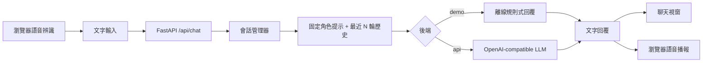

# 虛擬人智能交互：一個可替換 LLM 的多輪對話 Demo

> **閱讀建議**：讀完 Transformer 與 GPT 的基本章節後閱讀。本文把聊天模型接成一個最小虛擬學習夥伴，聚焦在角色設定、短期上下文、語音輸入與回覆播報，不依賴特定雲端模型。

## 背景與目標

聊天介面看起來只是一個輸入框，但一個穩定的虛擬角色至少需要三個部分：輸入轉成文字、對話管理器維護當前會話、LLM 根據固定角色與有限歷史產生回覆。本例用「小禾」作為學習夥伴，提供文字對話、瀏覽器語音辨識與語音播報；模型透過 OpenAI-compatible Chat Completions 接口呼叫，因此可以接本地 Ollama、vLLM 或相容服務。

專案也提供一個離線演示模式，讓讀者不需要 API key 就能先跑通頁面與多輪上下文。離線模式是規則式腳本，**不是 LLM**；切換到 `api` 模式才會把對話交給實際模型。

## 架構與資料流



| 模組 | 本例的責任 |
|:---|:---|
| `index.html` | 聊天介面、文字送出、可用時的語音輸入與回覆播報 |
| `app.py` | FastAPI 路由、輸入長度限制、會話快取與模型呼叫 |
| 角色 system prompt | 每次請求都放在歷史最前面，固定小禾的身份、語氣和安全邊界 |
| 會話歷史 | 只保留最近 `MAX_HISTORY_TURNS` 個完整來回；重設會話即可清除 |
| LLM 後端 | `api` 模式呼叫相容聊天 API；`demo` 模式用固定規則驗證交互流程 |

語音辨識由瀏覽器提供，辨識結果再當作一般文字送給 FastAPI；本服務不接收或儲存原始音訊。瀏覽器的語音辨識支援與處理方式依瀏覽器而異，可能使用瀏覽器供應商的語音服務；若不希望傳送音訊，請只用文字輸入。語音合成也由瀏覽器處理，不會經過模型 API。

## 角色與上下文如何保持穩定

1. **角色固定**：system prompt 不由前端提供，也不放入可被歷史裁切的對話區；每次呼叫模型都先附上同一份角色規則。
2. **上下文有界**：伺服器以隨機會話 ID 分開不同瀏覽器會話，只把最近幾輪完整問答送給模型，避免歷史無限制成長。
3. **更新有順序**：同一會話的請求由鎖序列化；只有模型成功回覆後才把這輪問答寫入歷史，失敗時可重試而不會留下半輪訊息。
4. **可清除**：重設按鈕建立新會話；舊會話只存在此 Python 程序的記憶體中，服務停止後會消失。
5. **可替換後端**：前端與會話管理不依賴模型廠商。調整環境變數即可切換成本地模型或其他相容端點。

這是單程序教學 Demo，不含登入、跨程序共享、資料庫、速率限制或正式部署的安全措施。不要公開綁定服務，也不要輸入個人敏感資訊。若使用雲端模型，對話文字會傳給設定的服務商。

## 目錄與環境

```text
virtual-human-interaction/
├── readme.md
└── code/
    ├── app.py
    ├── index.html
    └── requirements.txt
```

- Python 3.10+
- 離線演示：FastAPI、Uvicorn
- 真實模型：另需在本機啟動一個 OpenAI-compatible 聊天服務，或設定可用的 API 端點
- 本例不需要 PyTorch、語音模型權重或編譯器

## 實踐步驟

### 1. 安裝依賴並啟動離線 Demo

在專題的 `code/` 目錄執行：

```powershell
python -m venv .venv
.\.venv\Scripts\Activate.ps1
python -m pip install -r requirements.txt
python -m uvicorn app:app --host 127.0.0.1 --port 8000
```

macOS / Linux：

```bash
python3 -m venv .venv
source .venv/bin/activate
python -m pip install -r requirements.txt
python -m uvicorn app:app --host 127.0.0.1 --port 8000
```

打開 `http://127.0.0.1:8000`，預設是離線演示模式。可依序輸入：

1. `你好，我叫小明，我在學 Transformer。`
2. `你記得我在學什麼嗎？`

離線模式會用固定範例回覆，並從同一會話歷史找回名字或上一個主題，方便檢查多輪交互線路。它不代表模型理解能力、延遲或生成品質。

### 2. 接上真正的 LLM

以本機 Ollama 為例，先安裝並啟動 Ollama，確保已下載一個聊天模型。Ollama 提供相容的 `/v1/chat/completions` 介面，適合用來替換本例的離線後端；其他相容服務也可使用相同設定方式。

在另一個 PowerShell 視窗啟動 Web Demo：

```powershell
$env:VIRTUAL_HUMAN_MODE = "api"
$env:OPENAI_BASE_URL = "http://localhost:11434/v1"
$env:OPENAI_API_KEY = "ollama"
$env:OPENAI_MODEL = "qwen2.5:3b"
python -m uvicorn app:app --host 127.0.0.1 --port 8000
```

`OPENAI_API_KEY` 只會放在服務端的 HTTP header，不會送到瀏覽器。若改用雲端供應商，請將 `OPENAI_BASE_URL`、`OPENAI_MODEL` 和 `OPENAI_API_KEY` 換成該供應商提供的值，並留意其資料處理政策。不要把 API key 寫進程式碼或提交到 Git。

### 3. 語音互動

- 若目前瀏覽器支援 Web Speech `SpeechRecognition`，點「語音輸入」即可把辨識文字填入輸入框，再由使用者按送出。
- 點任一回覆旁的「朗讀」會使用瀏覽器的 `speechSynthesis` 播報文字。
- 語音辨識不是所有瀏覽器都支援；拒絕麥克風權限或 API 不可用時，文字輸入仍可完整使用。

### 4. API 與設定

| 變數 | 預設值 | 說明 |
|:---|:---|:---|
| `VIRTUAL_HUMAN_MODE` | `demo` | `demo` 使用規則式示範；`api` 呼叫真實聊天模型 |
| `OPENAI_BASE_URL` | `http://localhost:11434/v1` | 相容 API 的 base URL |
| `OPENAI_API_KEY` | 空 | 相容服務的 API key；本地 Ollama 可用任意佔位字串 |
| `OPENAI_MODEL` | `qwen2.5:3b` | 服務端已載入的模型名稱 |
| `MAX_HISTORY_TURNS` | `8` | 每次送給模型的最多歷史來回數 |
| `MAX_INPUT_CHARS` | `2000` | 單條使用者輸入字元上限 |

可透過 `http://127.0.0.1:8000/docs` 查看 FastAPI 自動產生的 API 文件；主要介面是 `POST /api/chat` 與 `POST /api/reset`。

## 經驗與限制

- **模型比 Demo 更重要**：不同模型對同一角色提示的遵循程度不同；若角色跑偏，可精簡 system prompt、明確列出語氣和禁止項，並用固定多輪腳本重複檢查。
- **上下文裁切有代價**：最近 N 輪的策略簡單、成本可控，但較早提到的資訊會被丟棄。若要長期記憶，應另設明確的摘要或可檢索記憶層，並提供使用者檢視與清除機制。
- **語音辨識是可選輸入層**：本例讓瀏覽器先辨識成文字，不把音訊送到 FastAPI；需要全離線或可審計的語音識別時，應換成可控的本地 ASR，並重新評估硬體與延遲。
- **不能把 Demo 當成真人或專業服務**：小禾只是教學角色，沒有身份驗證、持久化記憶或醫療、法律等專業能力。

## 與 Base LLM 主線的關係

- [第 4 章：Transformer 架構](../../docs/chapter4/12_transformer.md)：理解模型如何透過注意力處理上下文。
- [第 5 章：GPT 結構及應用](../../docs/chapter5/14_GPT.md)：理解自回歸聊天模型與訊息角色。
- [第 6 章：手搓一個大模型](../../docs/chapter6/17_handcraft_llama2.md)：從模型元件到生成流程的實作入口。

## 參考資料

1. [FastAPI First Steps](https://fastapi.tiangolo.com/tutorial/first-steps/)
2. [Ollama OpenAI compatibility](https://docs.ollama.com/api/openai-compatibility)
3. [MDN Web Speech API](https://developer.mozilla.org/en-US/docs/Web/API/Web_Speech_API)
4. [MDN SpeechRecognition](https://developer.mozilla.org/en-US/docs/Web/API/SpeechRecognition)（瀏覽器支援有限；因此本例保留文字輸入）
5. [MDN SpeechSynthesis](https://developer.mozilla.org/en-US/docs/Web/API/SpeechSynthesis)
