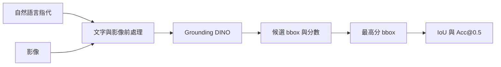

# 第四節 視覺定位：讓文字指向影像中的區域

視覺問答通常要求模型用文字回答「圖中有什麼」；**視覺定位**（Visual Grounding，也稱 referring expression comprehension）則要求模型根據一句自然語言指代，在影像中找出相符物件並輸出邊界框（bounding box，bbox）。例如輸入「靠窗坐著、穿紅色上衣的人」，輸出可以是影像左上角為原點的 `[x_min, y_min, x_max, y_max]`。

這個任務同時需要理解語句與辨認影像。若句子只說「一隻狗」，模型要找出所有相符區域；若句子說「左邊的人手上的杯子」，還要理解屬性、關係與相對位置。輸出框能直接用於點選、裁切、機器人操作或後續影像分析。

## 一、常見做法

視覺語言模型（VLM）可以依指令生成框座標，或產生帶有定位 token 的答案，例如 Qwen-VL 系列與 LLaVA 的定位能力；這種方式表達力強，但不同模型的座標格式、提示詞與解析方式可能不同。另一種做法是使用開放詞彙物件偵測器，將文字與影像一起輸入，直接取得一組帶分數的候選框。

本節選用 **Grounding DINO**。它把文字編碼器接入物件偵測器，支援以自然語言文字描述查找影像區域；Hugging Face Transformers 提供 `GroundingDinoProcessor` 與 `AutoModelForZeroShotObjectDetection`，可以把候選框轉為原始影像的像素座標。對單一指代表達，我們把整句作為查詢，再選取模型分數最高的框。這個最小基線不會解析多輪上下文，也不會在多個候選框間做複雜消歧，因此遇到含糊或較長的關係描述時可能失準。



## 二、邊界框與評測指標

常見框格式有兩種：

- COCO 標註格式 `[x, y, w, h]`，其中 `(x, y)` 是左上角，`w`、`h` 是寬與高。
- 推理輸出格式 `[x_min, y_min, x_max, y_max]`，用兩個對角點表示。

計算指標前要把兩種格式轉成同一座標系。框的交並比（Intersection over Union，IoU）是預測框與標註框交集面積除以聯集面積：

$$\operatorname{IoU}(B_p,B_g)=\frac{|B_p\cap B_g|}{|B_p\cup B_g|}$$

**Acc@0.5** 是 IoU 大於或等於 0.5 的樣本比例：

$$\operatorname{Acc@0.5}=\frac{1}{N}\sum_{i=1}^{N}\mathbf{1}[\operatorname{IoU}_i\ge 0.5]$$

若模型沒有產生框，該樣本的 IoU 計為 0。這個指標只看定位重疊，不衡量輸出文字是否流暢；小樣本結果也只能作為流程檢查，不能代表模型的正式基準成績。

## 三、最小可跑示例

示例程式放在 [`examples/visual_grounding`](../../examples/visual_grounding/)。它用 `IDEA-Research/grounding-dino-tiny` 載入預訓練模型，支援單張影像定位與 RefCOCOg 小樣本評測。第一次執行會下載模型權重；模型快取路徑可用 `HF_HOME` 指定。

### 3.1 安裝依賴

建議使用 Python 3.10 以上版本。請先依照 [PyTorch 官方安裝頁](https://pytorch.org/get-started/locally/)選擇作業系統、Python 與 CPU/CUDA 組合安裝 PyTorch，再安裝示例依賴。若要將模型權重快取在 D 槽，請在 PowerShell 設定 `HF_HOME`，例如 `$env:HF_HOME = "D:/datawhale/hf-cache"`。

```powershell
$env:HF_HOME = "D:/datawhale/hf-cache"
python -m venv .venv
.\.venv\Scripts\Activate.ps1
python -m pip install -r examples/visual_grounding/requirements.txt
```

macOS / Linux 可用 `source .venv/bin/activate` 啟用虛擬環境。

### 3.2 以自然語言定位

```bash
python examples/visual_grounding/demo.py --image path/to/image.jpg --text "the person wearing a red shirt by the window" --output grounding-result.jpg
```

程式會列印像素座標、模型分數與文字片段，並在輸出影像上繪製框。將自然語言直接交給開放詞彙偵測器是一個簡化基線；若提示詞是中文且模型反應不穩定，可先將描述翻成簡潔英文，或改用原生支援中文指代的 VLM。

### 3.3 RefCOCOg 小樣本評測

```bash
python examples/visual_grounding/prepare_refcocog_subset.py --output-dir D:/data/refcocog-mini --samples 8
python examples/visual_grounding/evaluate.py --dataset-dir D:/data/refcocog-mini --output D:/data/refcocog-mini/results.json
```

準備腳本會從固定 revision `702f10c` 的公開 RefCOCOg validation split 抽取最多 8 條不同影像的指代表達與 COCO bbox，並透過 HTTPS 下載所需影像。COCO 圖片與標註不會放入程式碼倉庫；下載與使用前請確認遵守[資料集與圖片來源條款](https://github.com/cocodataset/cocodataset.github.io/blob/master/dataset/termsofuse.htm)。執行評測會輸出每筆樣本的表達、預測框、IoU，以及整體平均 IoU、Acc@0.5 和未偵測數量。可調整 `--samples` 增加樣本數，也可在 GPU 記憶體不足時指定 `--device cpu`。

本節報告的測試結果將以程式實際執行的樣本數、模型 ID、閾值與指標為準。因為抽樣規模很小，且使用零樣本模型與固定抽樣種子，結果主要用來確認「指代 → bbox → IoU 評測」鏈路完整，不宜與論文或完整驗證集成績直接比較。

### 3.4 實測紀錄

使用 RefCOCOg validation 固定種子 `2026` 抽出的 8 張不同影像，載入 `IDEA-Research/grounding-dino-tiny`（revision `a2bb814`），於 Transformers `5.20.1`、PyTorch `2.13.0+cu132`、NVIDIA RTX 4060 上執行；候選框閾值為 `0.25`，文字閾值為 `0.20`。結果為平均 IoU **0.436**、Acc@0.5 **37.5%（3/8）**、未偵測 **0/8**：

| COCO image ID | 指代表達 | IoU | IoU ≥ 0.5 |
| --- | --- | ---: | :---: |
| 000000097563 | the man running behind the frisbee | 0.105 | 否 |
| 000000286690 | a black office chair with a coat hanging on it | 0.969 | 是 |
| 000000464650 | the blonde woman using a stick blender | 0.912 | 是 |
| 000000473500 | orange tabby cat standing in a sink | 0.954 | 是 |
| 000000083641 | a fake long john donut in a package | 0.151 | 否 |
| 000000199331 | a man in a blue shirt and blue shorts holding a green cone | 0.000 | 否 |
| 000000551316 | a blue striped tie on a man flying up in the air | 0.234 | 否 |
| 000000568725 | yellow section of a car and the wheel to the right of it | 0.160 | 否 |

這組小樣本中，簡短且具體的指代定位較準；較長的關係描述與局部物件容易偏向相鄰或更大的區域。此觀察僅來自上述 8 筆抽樣，不能外推到完整 RefCOCOg split。

## 參考資料

1. [Grounding DINO，Hugging Face Transformers 官方文件](https://huggingface.co/docs/transformers/main/en/model_doc/grounding-dino)
2. [IDEA-Research/grounding-dino-tiny 模型卡](https://huggingface.co/IDEA-Research/grounding-dino-tiny)
3. [Referring Expression Datasets API（RefCOCOg 資料格式與資料集說明）](https://github.com/lichengunc/refer)
4. [RefCOCOg validation split 的 Hugging Face 資料鏡像](https://huggingface.co/datasets/jhkwak-bp/refcocog-coco2017)
5. [COCO 使用條款](https://github.com/cocodataset/cocodataset.github.io/blob/master/dataset/termsofuse.htm)
