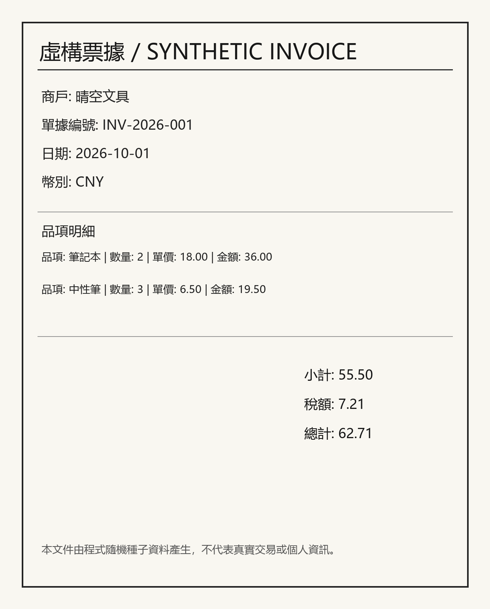

# 第四節 VLM OCR 與文檔結構化

票據、表格與 PDF 截圖都包含可見文字，但把文字讀出來只是第一步。實務上還要將欄位、行項目與數值整理成程式可消化的結構。本節比較傳統 OCR 管線與視覺語言模型（VLM）的端到端流程，並以固定合成票據集實測欄位準確率。

## 一、傳統 OCR 與 VLM 的分工

傳統 OCR 通常由文字區域偵測、文字方向校正、文字辨識及後續規則解析組成。以 [RapidOCR](https://github.com/RapidAI/RapidOCR) 為例，它可在 ONNX Runtime 上執行偵測與辨識；接著仍需用程式把輸出的文字行對應到欄位。欄位位置固定、字型清楚時，規則解析透明、速度快，也容易逐步除錯；遇到版面改變、掃描傾斜或同一欄位名稱變體時，規則可能失配。

VLM 將圖像和自然語言指令一起輸入模型，能利用版面及語意直接生成 JSON 或 Markdown。這省去了逐行文字到欄位的部分手工規則，但輸出是模型生成內容，仍可能漏欄位、改寫文字、猜測模糊數字或產生無效 JSON。生成式模型的方便性不能取代格式檢查、欄位驗證和人工覆核。

本實作採用 [Qwen2.5-VL-3B-Instruct](https://huggingface.co/Qwen/Qwen2.5-VL-3B-Instruct)，透過 Transformers 的 processor 將圖像整理成多模態輸入，使用 4-bit NF4 推理以降低顯存需求。RapidOCR 則使用 CPU ONNX Runtime。兩條流程共用同一組合成影像和標註。

## 二、從圖像到結構化輸出的資料流

```text
票據 PNG
  ├─ RapidOCR → OCR 文字行 → 標籤規則 → JSON
  └─ Qwen2.5-VL + schema 提示詞 → JSON 解析與型別整理
                                      ↓
                         標註比對、指標與失敗欄位
```

範例 schema 將商戶、單據編號、日期、幣別、小計、稅額、總計和品項列為 8 個頂層欄位。每個品項再包含名稱、數量、單價和金額。數字以字串保存，避免浮點數格式變化；items 是陣列而非將多行表格壓成一段文字。



### 2.1 傳統 OCR 後處理

`ocr_baseline.py` 用 RapidOCR 偵測並辨識圖中文字。`common.py` 對繁簡標籤和全形符號做有限正規化，再用正則式讀取值；缺欄位保留空字串，品項保留物件陣列。這種寫法容易理解，但高度依賴標籤文字和行排列。面對沒有標籤、跨行表格、手寫字或不同文件模板時，通常需要版面資訊、座標關係或專用欄位規則。

### 2.2 VLM 提示詞與輸出整理

VLM 提示詞把 schema 明列出來，要求只輸出 JSON，指定陣列與字串型別，保留票面數字小數位，並對無法辨認的內容輸出空值。程式只負責移除 Markdown 程式碼框、解析 JSON 和整理欄位型別，不會自行補算缺失數字。若 JSON 解析失敗，評估時會計入不可解析，而不把失敗文本當成正確結構。

在生產工作流程中可再加上 JSON Schema 驗證、金額範圍檢查、欄位信心值、影像裁切/旋轉、重試策略與人工覆核。金額校驗可以提示矛盾，但不能直接覆寫模型讀值，否則會把「模型辨識」與「商業規則推算」混為一談。

## 三、建立合成資料與執行

程式位於 [`examples/vlm_ocr/`](../../examples/vlm_ocr/README.md)。資料以虛構商戶名和固定票據欄位生成，不含真實個人或交易資訊。依 [PyTorch 官方安裝頁面](https://pytorch.org/get-started/locally/) 安裝相符的 CUDA 版本後，Windows 上可把模型快取放到 D 槽：

```powershell
$env:HF_HOME = 'D:\packages\dw-task125-ocr\hf-cache'
python -m pip install -r examples/vlm_ocr/requirements.txt
$data = 'D:\packages\dw-task125-ocr\data'
$results = 'D:\packages\dw-task125-ocr\results'
python examples/vlm_ocr/generate_dataset.py --out-dir $data
python examples/vlm_ocr/ocr_baseline.py --data-dir $data --output "$results\rapidocr.jsonl"
python examples/vlm_ocr/vlm_extract.py --data-dir $data --output "$results\qwen_vl.jsonl"
python examples/vlm_ocr/evaluate.py --ground-truth "$data\dataset.jsonl" `
  --predictions "$results\rapidocr.jsonl" "$results\qwen_vl.jsonl" `
  --names RapidOCR Qwen2.5-VL --output-dir "$results\evaluation"
```

第一次執行 VLM 流程會下載模型。8 GB 顯存可先用預設 4-bit 推理及 256–768 個視覺 patch；顯存不足時再降低 `max_pixels` 或逐張處理。依賴版本、GPU、驅動及 Transformers 版本不同，推理速度和輸出可能略有差異。

## 四、評測方式

評測腳本對每張影像的 8 個頂層欄位做精確比對，`items` 陣列也要求順序與內容完全相同。

- **欄位準確率**：逐欄精確命中的數量除以欄位總數，並列出每個欄位的命中率。
- **文件完全匹配率**：單張票據 8 欄全部正確才算命中。
- **字元準確率**：先把欄位值轉成固定字串，再以 Levenshtein 編輯距離計算 `1 - CER`。
- **JSON 可解析率**：VLM 回覆中成功解析 JSON 物件的樣本比例。
- **失敗明細**：報告列出每個錯誤欄位的標註值和模型/解析器的輸出，方便確認錯誤是否在辨字、欄位解析或生成格式。

### 實測結果

以下數字由 12 張固定模板合成票據的實際執行結果產生，更新後以 `examples/vlm_ocr/results/report.md` 為準。小樣本、同模板和明確標籤會使結果偏樂觀，不可當成真實文件基準。

| 方法 | JSON 可解析率 | 欄位準確率 | 文件完全匹配率 | 字元準確率 |
|---|---:|---:|---:|---:|
| RapidOCR + 標籤解析 | 100.00% | 97.92% | 83.33% | 99.86% |
| Qwen2.5-VL-3B-Instruct（4-bit NF4） | 100.00% | 100.00% | 100.00% | 100.00% |

兩種流程都使用相同的 12 張影像和 8 個頂層欄位。Qwen 在本次 96/96 個欄位全數命中，12/12 張文件完全匹配；RapidOCR 命中 94/96 個欄位。逐欄命中率、錯誤明細及逐樣本預測分別保存在 `examples/vlm_ocr/results/report.md`、`metrics.json` 和 `qwen_vl_predictions.jsonl`。本機實測環境為 NVIDIA RTX 4060 8 GB、PyTorch 2.13.0+cu132、Transformers 5.20.1；VLM 使用 4-bit NF4。

## 五、錯誤分析與適用範圍

此合成集用中文商戶名、編號、日期、兩個品項和金額組成。RapidOCR 的兩個失敗樣本都出在品項名稱：invoice-01 將「筆記本」「中性筆」辨成簡體字；invoice-05 將「裝訂服務」末字辨成簡體字。標籤與數值欄位均命中，因此 94/96 個欄位精確；items 陣列任一字不同就會使該欄不匹配。Qwen 本次沒有欄位錯誤，但 12 張同模板合成票據不足以證明它在真實文件上比傳統 OCR 更準。VLM 仍可能把小字讀錯或按提示詞自行補全，實際錯誤欄位由評估報告列出。

本實驗的 12 張票據全由腳本繪製，只有少數輕微模糊/傾斜變化，沒有涵蓋手寫、折痕、印章、複雜表格、跨頁 PDF、低解析度手機照片或多語混排。正式使用應先建立經授權且去識別化的代表性驗證集，分欄位測量錯誤，並對稅額、總額、帳號或人名等高風險欄位安排人工確認。

## 六、延伸練習

1. 將標籤解析換成座標分群或表格結構辨識，量測版面改變後的差異。
2. 增加旋轉、縮放和模糊樣本，分層檢視各類影像品質的錯誤率。
3. 給 VLM 加上 JSON Schema 驗證與人工覆核佇列，統計解析失敗和人工修正率。
4. 比較不同提示詞、解析度和模型大小時，固定資料集與解碼參數，避免把變更混在一起。
